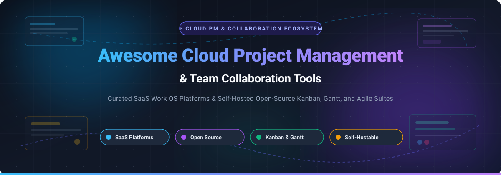

# 🚀 Awesome Cloud Project Management & Collaboration

### 🌐 The Definitive Directory of Work OS Platforms, Task Orchestration & Open-Source Collaboration Systems

  
  
  
  
  
  

  <b>A curated catalog of cloud project management tools, Work OS suites, agile boards, sprint planners, and self-hosted open-source collaboration platforms.</b>

---

## 📌 Table of Contents

- [📖 Introduction & Overview](#-introduction--overview)
- [📊 Sector Overview & Market Dynamics](#-sector-overview--market-dynamics)
- [☁️ SaaS / Hosted Work OS Platforms](#️-saas--hosted-work-os-platforms)
- [🔓 Open-Source GitHub Projects](#-open-source-github-projects)
- [🤝 How to Contribute](#-how-to-contribute)
- [⭐ Star History](#-star-history)
- [💖 Support](#-support)
- [📜 Disclaimer](#-disclaimer)

---

## 📖 Introduction & Overview

Modern engineering teams, remote enterprises, and digital agencies require unified systems to plan roadmaps, track tasks, schedule sprints, and automate cross-functional handoffs. This repository maintains a transparent, community-vetted reference guide for:

- **SaaS Work OS & PM Suites**: Feature-rich hosted solutions including Atlassian, Notion, Smartsheet, monday.com, ClickUp, and Asana.
- **Self-Hosted & Open-Source Software (FOSS)**: Self-hostable, privacy-preserving task boards, Gantt timelines, and agile issue trackers like AppFlowy, Plane, Focalboard, Super Productivity, and OpenProject.

---

## 📊 Sector Overview & Market Dynamics

The global **cloud project management and collaboration software market** was valued at approximately **$12.24 billion in 2026** and is projected to expand to **$47.52 billion by 2034**, advancing at a robust compound annual growth rate (**CAGR of 18.48%**). 

The industry demonstrates a **moderately concentrated distribution at the top tier alongside high overall fragmentation and competitive diversity**. While heavyweight market leaders (such as Atlassian, Smartsheet, monday.com, and Notion) command substantial enterprise volume, this sector is not a winner-take-all monopoly. Increasing enterprise demands for data sovereignty, custom developer workflows, and privacy compliance ensure that open-source alternatives and specialized agile frameworks continue to experience massive adoption.

---

## ☁️ SaaS / Hosted Work OS Platforms

The table below compiles leading cloud project management solutions with verified starting tiers, exact free tier / free trial limits, and estimated company size or valuation (ordered descending by company valuation / revenue):

| Product | Description | Starting Tier Pricing | Free Tier / Trial Limits | Company Size (Revenue / Valuation) |
|---|---|---|---|---|
| **[Trello (Atlassian)](https://trello.com/)** | Visual Kanban boards, lists, and cards with built-in Butler workflow automation. | Standard: $5.00/user/month (billed annually) or $6.00/user/month (billed monthly) | **Free Forever**: Up to 10 boards per workspace, unlimited cards, unlimited power-ups, 250 automation runs/month, 10 MB per file attachment. | ~$40.7B market capitalization (Atlassian NASDAQ: TEAM) |
| **[Zoho Projects](https://www.zoho.com/projects/)** | Cloud-based project management with task dependency Gantt charts, milestones, and issue tracking. | Premium: €5.00/user/month ($5.00/user/month, billed annually) | **Free Forever**: Up to 3 users, 2 projects, 10 MB file attachment limit, basic task tracking, and read-only Gantt view. | ~$12.5B estimated valuation (~$1.5B annual operating revenue) |
| **[Notion](https://www.notion.so/)** | Connected workspace unifying docs, project wikis, task boards, relational databases, and AI notes. | Plus: $10.00/user/month (billed annually) or $12.00/user/month (billed monthly) | **Free Forever**: Unlimited pages & blocks for individuals, up to 10 guest collaborators, 5 MB file upload limit, 7-day page version history. | ~$11.0B valuation (~$865M ARR run-rate) |
| **[Smartsheet](https://www.smartsheet.com/)** | Spreadsheet-inspired work execution platform with Gantt views, forms, card views, and automated flows. | Pro: $9.00/user/month (billed annually) or $12.00/user/month (billed monthly, max 10 users) | **30-Day Free Trial**: Full access to Business tier features (max 50 sheets, 100 email notifications/day to 20 unique recipients; no permanent free tier for new accounts). | ~$8.4B acquisition valuation (Blackstone & Vista Equity Partners) |
| **[monday.com](https://monday.com/)** | Highly customizable Work OS with workflow automation, dashboards, boards, and resource tracking. | Basic: $9.00/seat/month (billed annually, 3-seat minimum = $27/month) | **Free Forever**: Up to 2 users, 3 boards, 200+ templates, 500 MB storage; also offers a **14-day free trial** for Pro plan features. | ~$7.4B market capitalization (NASDAQ: MNDY) |
| **[ClickUp](https://clickup.com/)** | All-in-one productivity platform uniting tasks, Whiteboards, Dashboards, Chat, and Docs. | Unlimited: $7.00/user/month (billed annually) or $10.00/user/month (billed monthly) | **Free Forever**: Unlimited users/collaborators, 100 MB storage, unlimited tasks, collaborative docs, 24/7 support. | ~$4.0B valuation (Series C funding round) |
| **[Asana](https://asana.com/)** | Work management platform for organizing tasks, cross-team roadmaps, boards, and timelines. | Starter: $10.99/user/month (billed annually) or $13.49/user/month (billed monthly) | **Personal (Free)**: Up to 10 teammates, unlimited tasks, unlimited projects, unlimited messages, 100 MB per file limit (timeline & custom fields excluded). | ~$3.1B market capitalization (NYSE: ASAN) |
| **[Wrike](https://www.wrike.com/)** | Enterprise work management with interactive Gantts, cross-tagging, proofing, and workload charts. | Team: $9.80/user/month (billed annually, 2–25 seats) | **Free Forever**: Up to 5 users, basic task management, 2 GB storage; also provides a **14-day free trial** for Business/Enterprise tiers. | ~$2.25B acquisition valuation (Citrix Systems / STG, ~$140M+ ARR) |
| **[Basecamp](https://basecamp.com/)** | All-in-one project collaboration with to-dos, message boards, Campfire real-time chat, and schedules. | Basecamp: $15.00/user/month (billed monthly, no contract) or Basecamp Pro Unlimited at $299/month flat | **Free Plan**: 1 project, 20 users, 1 GB storage space; also provides a **30-day free trial** for full accounts without credit card. | ~$150M+ estimated annual revenue (bootstrapped by 37signals) |
| **[Teamwork](https://www.teamwork.com/)** | Client-centric project management suite with billable time tracking, client portals, and budget management. | Basics: $9.99/user/month (billed annually, 3-user minimum = $29.97/month) | **Free Forever**: Up to 5 users, 5 active projects, basic task boards, milestone tracking, and 100 MB file storage. | ~$80M+ estimated annual revenue (~$70M growth equity funding) |

---

## 🔓 Open-Source GitHub Projects

The following self-hosted and community-driven project management tools are ranked in descending order by their GitHub star count:

| Project | Star Badge | Description |
|---|---|---|
| **[AppFlowy](https://github.com/appflowy-io/AppFlowy)** |  | Open-source Notion alternative built with Flutter and Rust for offline-first data control, custom database views, Kanban boards, and collaborative document editing. |
| **[Plane](https://github.com/makeplane/plane)** |  | Modern open-source project management platform positioned as an extensible Jira and ClickUp alternative. Features work items, sprint Cycles, roadmap Modules, Pages (wikis), and triage workflows. |
| **[Focalboard](https://github.com/mattermost/focalboard)** |  | Self-hosted project management tool by Mattermost providing Kanban boards, table views, and card templates as an open alternative to Trello, Notion, and Asana. |
| **[Super Productivity](https://github.com/super-productivity/super-productivity)** |  | Advanced to-do list, time-tracker, and task management application with direct Jira, GitHub, and GitLab two-way sync, time logging, and productivity metrics. |
| **[Wekan](https://github.com/wekan/wekan)** |  | Mature open-source Kanban board built on Meteor/Node.js featuring real-time card synchronization, swimlanes, custom fields, and self-hosted Docker deployment. |
| **[OpenProject](https://github.com/opf/openproject)** |  | Enterprise-grade open-source project management suite featuring Gantt charts, Agile boards, work breakdown structures, project portfolio tracking, and meeting agendas. |
| **[Planka](https://github.com/plankanban/planka)** |  | Lightweight real-time collaborative Kanban board built with React and Redux, featuring member management, card labels, timers, and attachments. |
| **[Leantime](https://github.com/leantime/leantime)** |  | Open-source strategic project management system combining lean management, design thinking, milestone tracking, and task management tailored for small teams. |
| **[Kanboard](https://github.com/kanboard/kanboard)** |  | Minimalist Kanban project management software focused on simplicity, clear visual task flow, WIP limits, automated actions, and self-hosting with minimal resource overhead. |
| **[Redmine](https://github.com/redmine/redmine)** |  | Battle-tested open-source web-based project management application written in Ruby on Rails with multi-project support, role-based access control, issue tracking, and Gantt charts. |
| **[Vikunja](https://github.com/go-vikunja/vikunja)** |  | Full-featured to-do and task management platform supporting Kanban, Gantt, list, and table views, built-in CalDAV synchronization, and self-hosting via Docker Compose. |

---

## 🤝 How to Contribute

Contributions are welcome! Please help keep this curated list accurate and comprehensive:

1. 🍴 **Fork the repository**.
2. 🌿 **Create a descriptive branch** (`git checkout -b feature/add-new-tool`).
3. ✍️ **Add or update an entry** in `README.md` following the established table structure.
   - For SaaS tools: include verified starting tier pricing, explicit free tier / free trial limits, and company valuation or revenue.
   - For open-source tools: include the official repository link, star badge (`style=social&color=white` linking to stargazers), and concise description.
4. 🚀 **Submit a Pull Request** with a clear explanation of your additions or changes.

---

## ⭐ Star History

---

## 💖 Support

Thank you for visiting and using this resource! If you find this curated ecosystem helpful, please consider supporting the project:

- ⭐ **Star this repository** on GitHub to help others discover it.
- 🍴 **Fork & Share** it with your fellow engineering, product, and operations teammates.
- ☕ **Buy me a coffee / Sponsor**: Support ongoing maintenance and curation on the [GitHub Sponsor Dashboard](https://github.com/sponsors/ishandutta2007).

---

## 📜 Disclaimer

- This repository is a **community-curated** list provided for informational purposes only and does not constitute a formal commercial endorsement.
- Cloud project management systems handle business-critical workflows and communication; always conduct your own security, access control, and compliance audits before adopting any tool.
- Pricing plans, tier features, and free limits are subject to change by respective vendors.

---

  Built with ❤️ for project managers, product leads, DevOps engineers, and distributed teams worldwide.

